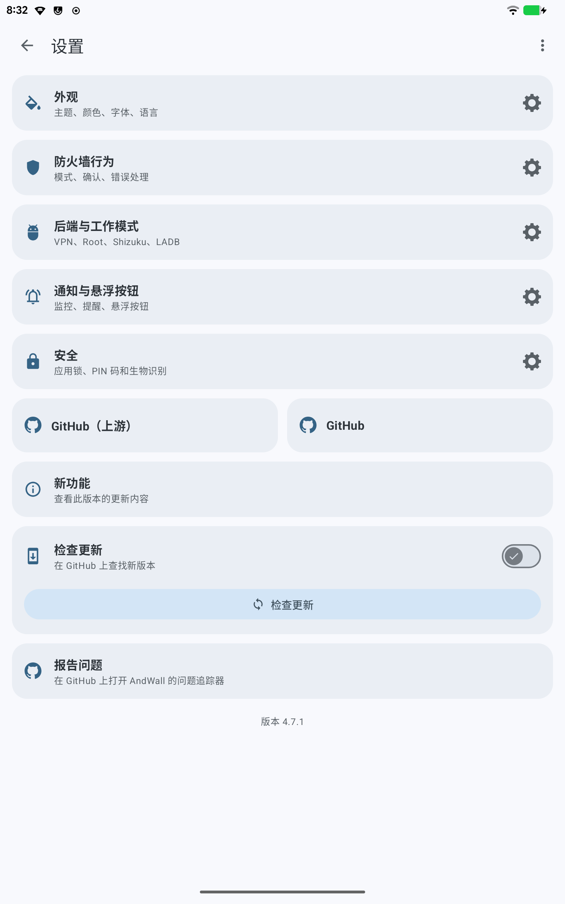

<div align="center">
  <a href="https://github.com/hsushjk/AndWall">
    
  </a>
  <h1>AndWall</h1>
  <strong>جدار حماية لأندرويد مع خلفية VPN محلية اختيارية.</strong><br/>
  الخصوصية أولًا، محلي بالكامل، يعمل عبر خلفية VPN مدمجة لا تحتاج إلى أي إعداد — أو عبر Shizuku / خدمة ADB المحلية / الروت للأوضاع المتقدمة.
</div>

<p align="center">
  <a href="../README.md">English</a> ·
  <a href="README.tr.md">Türkçe</a> ·
  <a href="README.de.md">Deutsch</a> ·
  <a href="README.it.md">Italiano</a> ·
  <a href="README.pt.md">Português</a> ·
  <a href="README.cs.md">Čeština</a> ·
  <a href="README.ru.md">Русский</a> ·
  <b>العربية</b> ·
  <a href="README.hi.md">हिन्दी</a> ·
  <a href="README.zh.md">中文</a> ·
  <a href="README.ja.md">日本語</a>
</p>
<div style="height: 20px;">&nbsp;</div>
<p align="center">
  <a href="https://tooomm.github.io/github-release-stats/?username=hsushjk&repository=AndWall">
    
  </a>
  
  
</p>

<p align="center">
  <a href="https://github.com/hsushjk/AndWall/issues">أسئلة ومشكلات</a> ·
  <a href="https://github.com/AhmetCanArslan/ShizuWall">المشروع الأصلي (ShizuWall)</a>
</p>

## يعمل مع

أندرويد 11 أو أحدث وإحدى هذه الواجهات الخلفية:

- **VPN**: خلفية VPN محلية مدمجة، لا تحتاج إلى إعداد ولا إلى تطبيق مساعد (تطبيقات المستخدم الحالي فقط)
- **Shizuku** (الإصدارات المشتقة مدعومة)
- **LibADB**: يقترن عبر تصحيح الأخطاء اللاسلكي، دون الحاجة إلى حاسوب
- **Root**

تبدأ عمليات التثبيت الجديدة بخلفية **VPN** ووضع جدار الحماية **القائمة البيضاء**، فيعمل التطبيق مباشرة. ويمكن اختيار الواجهات الخلفية الأخرى لاحقًا من **الإعدادات ← الخلفية ووضع التشغيل**.

## لماذا AndWall

- **لا حاجة إلى إعدادات مميزة في وضع VPN**: فقط امنح موافقة النظام على VPN مرة واحدة — بلا Shizuku، بلا ADB، بلا روت.
- **تحكّم لكل تطبيق**: يحظر الشبكة لكل تطبيق على حدة، بما في ذلك نسخ ملف العمل والنسخ المستنسخة في أوضاع السلسلة 3.
- **خصوصية**: يعمل دون اتصال أولًا، بلا تحليلات، بلا قياس عن بُعد، وبلا خادم VPN بعيد — النفق محلي وتُسقَط كل الحزم.
- **وصول سريع**: مربّع الإعدادات السريعة، وأداة الشاشة الرئيسية (ويدجت)، والزر العائم.
- **أتمتة**: يمكن التحكّم به عبر رسائل البث من adb وTasker وMacroDroid وما شابه.

## لقطة الشاشة

<p align="center">
  
  
</p>

## كيف يعمل

تحتاج خلفيات Shizuku وLibADB وRoot فقط إلى مساعد مميّز. وهي تتحكم في **السلسلة 3** (chain 3) في خدمة connectivity بأندرويد، وهي آلية في النظام تتحكّم في الوصول إلى الشبكة لكل حزمة:

```bash
cmd connectivity set-chain3-enabled true                                # تشغيل جدار الحماية
cmd connectivity set-package-networking-enabled false <package.name>   # حظر
cmd connectivity set-package-networking-enabled true <package.name>    # إلغاء الحظر
cmd connectivity set-chain3-enabled false                               # إيقاف جدار الحماية
```

يمسح أندرويد هذه القواعد عند إعادة التشغيل.

### خلفية VPN

خلفية VPN هي جهاز tun محلي من نوع `VpnService` يلتقط فقط التطبيقات التي تختار حظرها ويُسقِط كل حزمة يستقبلها. وتحتاج إلى مربع حوار موافقة واحد من النظام ولا تحتاج إلى أي إعداد آخر. وهي الخلفية الافتراضية للتثبيتات الجديدة، مقترنة بوضع جدار الحماية **القائمة البيضاء** (اختر التطبيقات المسموح لها، ويُحظر كل ما عداها)، ويمكن تغييرها من **الإعدادات ← الخلفية ووضع التشغيل**.

يُعاد تشغيل النفق تلقائيًا بعد إعادة التشغيل، وإذا توقفت عملية التطبيق أثناء تشغيل جدار الحماية، تُستعاد الحماية في المرة التالية التي يُفتح فيها AndWall. ووضع قفل الشاشة مدعوم (يتبع النفق حالة القفل) طالما أن الجهاز يملك قفل شاشة.

قيود خلفية VPN: فهي تتعامل مع تطبيقات المستخدم الحالي فقط (لا نسخ ملف العمل أو النسخ المستنسخة)، وقواعد بيانات الجوال فقط والأوضاع المعتمدة على كشف التطبيق الأمامي غير متاحة، ويُحتفظ بمجموعة التطبيقات المحظورة دون سلاسل جدار حماية لكل UID. ولمثل هذه الميزات، واصل استخدام Shizuku أو LibADB أو Root.

## التغييرات في هذا الفرع

AndWall هو فرع (fork) من [ShizuWall](https://github.com/AhmetCanArslan/ShizuWall). يضيف هذا الفرع:

- **خلفية VPN**: خلفية جدار حماية لا تحتاج إلى إعداد وتعمل مباشرة بعد مربع حوار الموافقة من النظام.
- **إعدادات افتراضية للمستخدمين الجدد**: خلفية VPN، ووضع جدار الحماية القائمة البيضاء، وإخفاء التطبيقات التي لا تملك وصولًا إلى الشبكة.
- **تجربة بدء تحديثة**: يشير تدفّق الترحيب واختيار الوضع إلى الواجهات الخلفية الأربع جميعها.
- **تكييف الواجهة مع وضع VPN**: تُخفى أوضاع جدار الحماية والميزات التي لا تستطيع خلفية VPN توفيرها، ويعود وضع جدار الحماية إلى القائمة البيضاء.
- **إعادة تسمية وتحديث مدخلات الإعدادات والترجمات**، إضافة إلى سجلات تغييرات أكبر وفحوص تحديث لهذا الفرع.

## الأتمتة

كل رسالة بث تحتاج إلى واجهة تحكّم نشطة. `apps` قائمة مفاتيح تطبيقات مفصولة بفواصل: اسم الحزمة المجرّد يستهدف المستخدم 0، والمفتاح ذو البادئة مثل `150:com.example.app` يستهدف النسخة الموجودة في ملف العمل أو مساحة النسخ تلك.

### جدار الحماية: `shizuwall.CONTROL`

| المعامل | النوع | |
|---|---|---|
| `state` | boolean، مطلوب | `true` = حظر، `false` = إلغاء الحظر |
| `apps` | string، اختياري | التطبيقات المراد حظرها أو إلغاء حظرها. بدونه يبدّل البث حالة جدار الحماية كلّه. |

```bash
# تشغيل جدار الحماية (state false يوقفه)
adb shell am broadcast -a shizuwall.CONTROL -n com.arslan.shizuwall/.receivers.FirewallControlReceiver --ez state true

# حظر تطبيق ونسخته في ملف العمل (state false يلغي حظرهما)
adb shell am broadcast -a shizuwall.CONTROL -n com.arslan.shizuwall/.receivers.FirewallControlReceiver --ez state true --es apps "com.example.app,150:com.example.app"
```

مع `apps`، يتبع التحديد داخل التطبيق: `state true` يحدّد التطبيقات ويشغّل جدار الحماية إن كان متوقفاً، و`state false` يلغي تحديدها ويُبقي جدار الحماية يعمل. في وضع القائمة البيضاء يشير `apps` إلى قائمة المسموح لها، فتنعكس الحالتان.

في وضع VPN، تعمل رسائل البث بالطريقة نفسها، لكن يجب أن يشير `apps` إلى تطبيقات المستخدم الحالي فقط؛ يتم تجاوز مفاتيح ملف العمل.

### تطبيق جديد: `shizuwall.APP_INSTALLED`

يُبلّغ عن تطبيق ثُبّت حديثاً، فتُطبَّق عليه سياسة التطبيقات الجديدة وإشعارها كما لو أن AndWall اكتشف التثبيت بنفسه. لا يرى AndWall إلا عمليات التثبيت في ملفه الشخصي، وهذه هي طريقة تغطية الملفات الأخرى.

```bash
adb shell am broadcast -a shizuwall.APP_INSTALLED -n com.arslan.shizuwall/.receivers.AppInstalledReceiver --es apps "com.example.newapp"
```

لا تُطبَّق أي قاعدة أثناء إيقاف جدار الحماية. يتم تجاهل التطبيقات التي لا تملك إذن `INTERNET`.

### ملف التعريف: `shizuwall.PROFILE`

يفعّل ملف تعريف محفوظاً: تحديد التطبيقات فيه، ووضع جدار الحماية، وأوضاع التطبيقات المنفردة، وإعداد *إظهار تطبيقات النظام*.

| المعامل | النوع | |
|---|---|---|
| `profile` | string | اسم ملف التعريف كما يظهر في قائمة ملفات التعريف. |
| `profile_id` | string | المعرّف الداخلي؛ يُفحص أولاً ولا يتأثر بإعادة التسمية. تعرض نافذة **الأتمتة** الخاصة بملف التعريف الأمر جاهزاً. |
| `force_enable` | boolean، اختياري | تشغيل جدار الحماية بعد التبديل حتى لو كان متوقفاً. |

أحد `profile` أو `profile_id` مطلوب. إن لم يطابق أيٌّ منهما فلا يتغيّر شيء وتظهر رسالة قصيرة (toast) بذلك.

```bash
adb shell am broadcast -a shizuwall.PROFILE -n com.arslan.shizuwall/.receivers.ProfileControlReceiver --es profile "Work"
```

## البناء من المصدر

يُبنى المشروع باستخدام Gradle wrapper وAndroid SDK:

```bash
./gradlew assembleDebug
```

يستخدم بناء التصحيح اللاحقة `.debug` ويمكن تثبيته إلى جانب بناء الإصدار. ويتطلب بناء الإصدار إعداد توقيع خاصاً بك.

## إخلاء المسؤولية

يُقدَّم AndWall **"كما هو"** دون أي ضمان. يعتمد على أذونات نظام متقدمة، والمطوّر غير مسؤول عن عدم استقرار النظام أو فقدان البيانات أو الآثار الجانبية لحظر الشبكة. تحقّق دائمًا من التطبيقات التي تحظرها.

يُوزَّع هذا الفرع فقط عبر [مستودع GitHub هذا](https://github.com/hsushjk/AndWall). أي ملفات APK من أي مكان آخر غير تابعة للمشروع وتُستخدم على مسؤوليتك. ليس لـ AndWall أي موقع ويب رسمي وليست منشورة على Google Play أو F-Droid.

يُطلب إذن `INTERNET` فقط لاقتران تصحيح الأخطاء اللاسلكي (LibADB).

## الترخيص

[GPLv3](../LICENSE.md). بيانات تواقيع المتتبّعات المضمّنة مرخّصة بشكل منفصل وفق ODbL v1.0، انظر [TRACKER_DATA_LICENSE.md](../TRACKER_DATA_LICENSE.md).

## شكر وتقدير

- [ShizuWall](https://github.com/AhmetCanArslan/ShizuWall): المشروع الأصلي الذي يستند إليه هذا الفرع.
- [Shizuku](https://github.com/RikkaApps/Shizuku): تنفيذ الأوامر ذات الصلاحيات.
- [LibADB](https://github.com/MuntashirAkon/libadb-android): تصحيح الأخطاء اللاسلكي والاتصال بالخدمة.
- [Exodus Privacy](https://exodus-privacy.eu.org/): قاعدة بيانات تواقيع المتتبّعات. يضمّ AndWall نسخة مختصرة منها ولا يتصل بواجهتهم البرمجية أبداً.