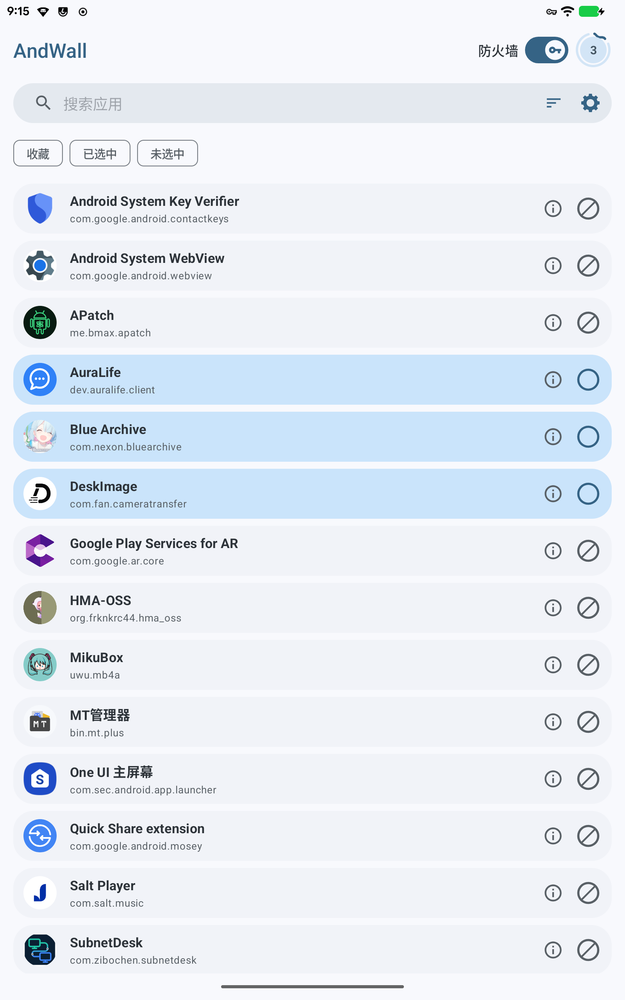

<div align="center">
  <a href="https://github.com/hsushjk/AndWall">
    
  </a>
  <h1>AndWall</h1>
  <strong>Android-Firewall mit optionalem lokalem VPN-Backend.</strong><br/>
  Datenschutzorientiert und vollständig lokal, angetrieben von einem integrierten VPN-Backend ohne jede Konfiguration – im erweiterten Modus über Shizuku / lokalen ADB-Daemon / Root.
</div>

<p align="center">
  <a href="README.en.md">English</a> ·
  <a href="README.tr.md">Türkçe</a> ·
  <b>Deutsch</b> ·
  <a href="README.es.md">Español</a> ·
  <a href="README.it.md">Italiano</a> ·
  <a href="README.pt.md">Português</a> ·
  <a href="README.cs.md">Čeština</a> ·
  <a href="README.ru.md">Русский</a> ·
  <a href="README.ar.md">العربية</a> ·
  <a href="README.hi.md">हिन्दी</a> ·
  <a href="../README.md">中文</a> ·
  <a href="README.ja.md">日本語</a>
</p>
<div style="height: 20px;">&nbsp;</div>
<p align="center">
  <a href="https://tooomm.github.io/github-release-stats/?username=hsushjk&repository=AndWall">
    
  </a>
  
  
</p>

<p align="center">
  <a href="https://github.com/hsushjk/AndWall/issues">Fragen & Feedback</a> ·
  <a href="https://github.com/AhmetCanArslan/ShizuWall">Upstream-Projekt (ShizuWall)</a>
</p>

## Kompatible Umgebung

Android 11 oder höher sowie eines der folgenden Backends:

- **VPN**: integriertes lokales VPN-Backend, ohne Konfiguration und ohne Begleit-App (nur Apps des aktuellen Benutzers)
- **Shizuku** (unterstützte Fork-Builds)
- **LibADB**: Pairing über drahtloses Debugging, kein Computer nötig
- **Root**

Nach einer Neuinstallation nutzt AndWall standardmäßig das **VPN**-Backend und den Firewall-Modus **Whitelist** und ist damit sofort einsatzbereit. Andere Backends lassen sich später unter **Einstellungen → Backend und Arbeitsmodus** auswählen.

## Warum AndWall

- **VPN-Modus ohne privilegierte Konfiguration**: Es genügt eine einmalige Freigabe des System-VPN – kein Shizuku, kein ADB, kein Root.
- **Steuerung pro App**: Netzwerkzugriff pro App blockieren, im Chain-Modus auch Arbeitsprofile und geklonte App-Kopien.
- **Datenschutz**: Offline-first, keine Analysen, keine Telemetrie, kein Remote-VPN-Server – der Tunnel bleibt vollständig lokal, alle Pakete werden verworfen.
- **Schnellzugriff**: Kachel in den Schnelleinstellungen, Widgets und schwebende Schaltfläche.
- **Automatisierung**: Steuerung über Broadcasts von adb, Tasker, MacroDroid und anderen.

## Screenshots

<p align="center">
  
  
</p>

## Funktionsweise

Nur die Backends Shizuku, LibADB und Root benötigen eine privilegierte Begleitkomponente. Sie nutzen **chain 3** der Android-Connectivity, einen Plattformmechanismus zur paketbasierten Steuerung des Netzwerkzugriffs:

```bash
cmd connectivity set-chain3-enabled true                                # Firewall aktivieren
cmd connectivity set-package-networking-enabled false <package.name>   # Blockieren
cmd connectivity set-package-networking-enabled true <package.name>    # Blockierung aufheben
cmd connectivity set-chain3-enabled false                               # Firewall deaktivieren
```

Android entfernt diese Regeln bei einem Geräteneustart.

### VPN-Backend

Das VPN-Backend ist ein lokales `VpnService`-Tun-Gerät, das nur die von dir zum Blockieren ausgewählten Apps erfasst und alle empfangenen Pakete verwirft. Es benötigt lediglich einen einmaligen System-Berechtigungsdialog, sonst keine Einrichtung. Neue Installationen nutzen dieses Backend standardmäßig zusammen mit dem Firewall-Modus **Whitelist** (die Apps auswählen, die Netzwerkzugriff haben sollen; alles andere wird blockiert); änderbar unter **Einstellungen → Backend und Arbeitsmodus**.

Nach einem Neustart startet der Tunnel automatisch wieder; wird der App-Prozess bei aktiver Firewall beendet, stellt AndWall den Schutz beim nächsten Öffnen wieder her. Sofern das Gerät eine Bildschirmsperre hat, wird ein Sperrbildschirm-Modus unterstützt (der Tunnel folgt dem Sperrstatus).

Einschränkungen des VPN-Backends: Es verarbeitet nur Apps des aktuellen Benutzers (keine Arbeitsprofile bzw. geklonten Kopien), unterstützt keine Regeln, die nur für mobile Daten gelten, und keine auf Vordergrunderkennung basierenden Modi, und die Pflege der blockierten App-Menge hängt nicht von UID-basierten Firewall-Ketten ab. Für diese Funktionen weiterhin Shizuku, LibADB oder Root verwenden.

## Änderungen in diesem Fork

AndWall ist ein Fork von [ShizuWall](https://github.com/AhmetCanArslan/ShizuWall). Dieser Fork ergänzt:

- **VPN-Backend**: ein konfigurationsfreies Firewall-Backend, das nur die Bestätigung des System-Berechtigungsdialogs erfordert.
- **Neue Standardeinstellungen**: VPN-Backend, Whitelist-Firewall-Modus und Ausblenden von Apps ohne Netzwerkberechtigung.
- **Überarbeiteter Einführungsablauf**: Willkommensablauf und Modusauswahl nennen jetzt alle vier Backends.
- **Angepasste Oberfläche für den VPN-Modus**: Firewall-Modi und Funktionen, die das VPN-Backend nicht bieten kann, werden ausgeblendet, und der Firewall-Modus fällt auf Whitelist zurück.
- **Neues Branding, aktualisierte Einstellungen und Übersetzungen** sowie ein ausführlicheres Änderungsprotokoll und eine Update-Prüfung für diesen Fork.

## Automatisierung

Jeder Broadcast benötigt ein aktives Backend. `apps` ist eine kommagetrennte Liste von App-Schlüsseln: eine reine Paketangabe steht für Benutzer 0, ein Präfix (z. B. `150:com.example.app`) für die Kopie in jenem Arbeitsprofil bzw. Klon-Bereich.

### Firewall: `shizuwall.CONTROL`

| Parameter | Typ | |
|---|---|---|
| `state` | boolean, erforderlich | `true` = blockieren, `false` = Blockierung aufheben |
| `apps` | string, optional | Apps, die blockiert oder freigegeben werden sollen. Ohne Angabe schaltet der Broadcast die gesamte Firewall um. |

```bash
# Firewall aktivieren (state false bedeutet deaktivieren)
adb shell am broadcast -a shizuwall.CONTROL -n com.arslan.shizuwall/.receivers.FirewallControlReceiver --ez state true

# Eine App samt Kopie im Arbeitsprofil blockieren (state false hebt die Blockierung auf)
adb shell am broadcast -a shizuwall.CONTROL -n com.arslan.shizuwall/.receivers.FirewallControlReceiver --ez state true --es apps "com.example.app,150:com.example.app"
```

Mit `apps` wird die Auswahl in der App synchron gehalten: `state true` wählt diese Apps aus und aktiviert die Firewall, falls sie zuvor aus war; `state false` hebt die Auswahl auf und lässt die Firewall aktiv. Im Whitelist-Modus bezieht sich `apps` auf die Erlaubnisliste, daher sind die beiden Zustände genau umgekehrt zu verstehen.

Im VPN-Modus funktionieren die Broadcasts genauso, aber `apps` sollte nur Apps des aktuellen Benutzers referenzieren; Schlüssel für Arbeitsprofile werden übersprungen.

### Neue App: `shizuwall.APP_INSTALLED`

Meldet eine neu installierte App, damit die Richtlinie für neue Apps und Benachrichtigungen greifen, als hätte AndWall die Installation selbst erkannt. AndWall sieht nur Installationen im eigenen Benutzerprofil, daher müssen andere Profile auf diesem Weg abgedeckt werden.

```bash
adb shell am broadcast -a shizuwall.APP_INSTALLED -n com.arslan.shizuwall/.receivers.AppInstalledReceiver --es apps "com.example.newapp"
```

Bei deaktivierter Firewall werden keine Regeln angewendet. Apps ohne die Berechtigung `INTERNET` werden ignoriert.

### Profil: `shizuwall.PROFILE`

Aktiviert ein gespeichertes Profil: übernimmt die App-Auswahl, den Firewall-Modus, den Modus pro App und die Einstellung *System-Apps anzeigen* dieses Profils.

| Parameter | Typ | |
|---|---|---|
| `profile` | string | Name des Profils, wie im Profil-Panel angezeigt. |
| `profile_id` | string | Interne ID; wird zuerst geprüft und ist von Umbenennungen unabhängig. Der fertige Befehl wird im Dialog **Automatisierung** dieses Profils angezeigt. |
| `force_enable` | boolean, optional | Schaltet die Firewall nach dem Wechsel ein, auch wenn sie zuvor aus war. |

Mindestens eines von `profile` und `profile_id` muss angegeben werden. Passt keines von beiden, ändert sich nichts, und ein Toast weist darauf hin.

```bash
adb shell am broadcast -a shizuwall.PROFILE -n com.arslan.shizuwall/.receivers.ProfileControlReceiver --es profile "Work"
```

## Aus dem Quellcode bauen

Dieses Projekt wird mit dem Gradle Wrapper und dem Android SDK gebaut:

```bash
./gradlew assembleDebug
```

Debug-Builds verwenden das Suffix `.debug` und lassen sich parallel zur Release-Version installieren. Release-Builds erfordern deine eigene Signaturkonfiguration.

## Haftungsausschluss

AndWall wird **„wie besehen“** und ohne jegliche Gewährleistung bereitgestellt. Es benötigt erweiterte Systemrechte, und der Entwickler haftet nicht für Systeminstabilität, Datenverlust oder Nebenwirkungen der Netzwerkblockierung. Prüfe sorgfältig, welche Apps du blockierst.

Dieser Fork wird ausschließlich über [dieses GitHub-Repository](https://github.com/hsushjk/AndWall) verbreitet. APKs aus anderen Quellen stehen in keiner Verbindung zu diesem Projekt; die Nutzung erfolgt auf eigene Gefahr. AndWall hat keine offizielle Website und ist weder bei Google Play noch bei F-Droid erschienen.

Die Berechtigung `INTERNET` wird nur für das Pairing über drahtloses Debugging (LibADB) benötigt.

## Lizenz

[GPLv3](../LICENSE.md). Die mitgelieferten Tracker-Signaturdaten sind separat unter ODbL v1.0 lizenziert, siehe [TRACKER_DATA_LICENSE.md](../TRACKER_DATA_LICENSE.md).

## Danksagung

- [ShizuWall](https://github.com/AhmetCanArslan/ShizuWall): das Upstream-Projekt, auf dem dieser Fork basiert.
- [Shizuku](https://github.com/RikkaApps/Shizuku): Ausführung privilegierter Befehle.
- [LibADB](https://github.com/MuntashirAkon/libadb-android): drahtloses Debugging und Daemon-Verbindung.
- [Exodus Privacy](https://exodus-privacy.eu.org/): Datenbank der Tracker-Signaturen. AndWall enthält eine reduzierte Kopie und greift nie auf deren API zu.
